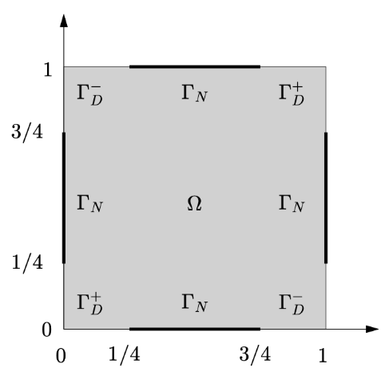
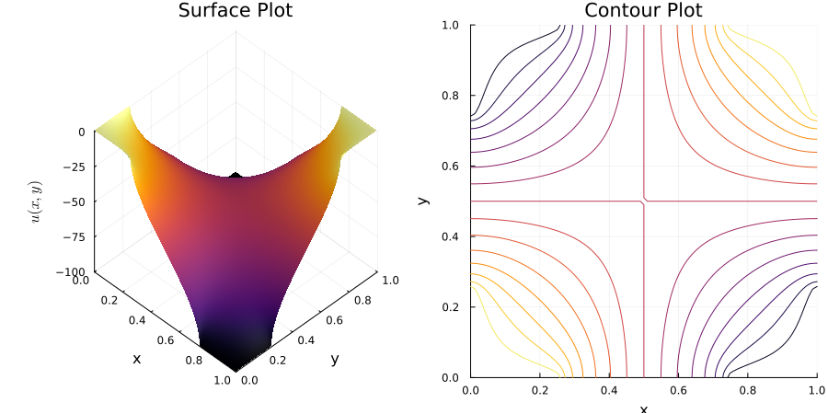

# 2D Laplace Equation Solver with Mixed Boundary Conditions

A robust, high-performance numerical solver based on the Finite Difference Method (FDM) implemented in Julia for the 2D Laplace equation ($\Delta u = 0$) on a unit square domain $\Omega = (0,1)^2$. 

## Mathematical Formulation

The solver addresses the following boundary value problem, commonly found in electrostatics or steady-state heat conduction:

$$ -u_{xx}(x,y) - u_{yy}(x,y) = 0, \quad (x,y) \in \Omega $$

With mixed boundary conditions along $\partial \Omega$:
* **Dirichlet boundaries ($\Gamma_D$):** Fixed values $u^+$ and $u^-$.
* **Neumann boundaries ($\Gamma_N$):** Homogeneous insulation conditions $\frac{\partial u}{\partial \nu} = 0$.

The specific distribution of these boundaries along the edges of the unit square $\Omega = (0,1)^2$ is illustrated in the domain sketch below:



## Implementation Highlights

To ensure scalability and memory efficiency, this implementation entirely avoids dense matrix instantiation. Key technical features include:

* **Sparse Matrix Architecture:** Utilization of Julia's `SparseArrays` to construct 1D operator matrices.
* **Kronecker Products:** The 2D differential operators ($A_h$) are built cleanly and efficiently via tensor products (`kron`) of 1D boundary indicators and finite difference matrices.
* **Second-Order Taylor Approximations:** Used for the Neumann boundary conditions to maintain numerical accuracy at the domain edges.

## Requirements

The codebase relies on standard numerical and visualization libraries in Julia:
* `LinearAlgebra`
* `SparseArrays`
* `Plots`
* `LaTeXStrings`

## Usage

You can run the solver directly from the Julia REPL. The code is modularized inside the `LaplaceSolver` module.

```julia
# Include the source code
include("src/LaplaceSolver.jl")
using .LaplaceSolver

# Solve the system for a 100x100 grid and generate the plots
solve_laplace_mixed_bcs(n=100, uplus=1.0, uminus=-100.0)
```

## Results
The following plots illustrate the numerical solution for a $100 \times 100$ grid, clearly showing the transition between the fixed Dirichlet values and the zero-flux Neumann boundaries:

